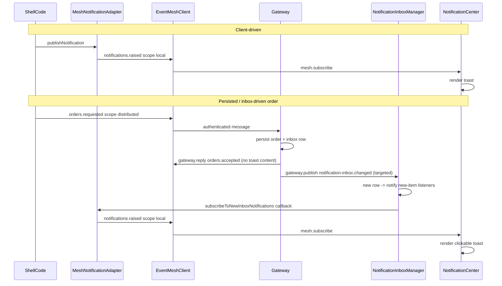

# Notifications over Event Mesh

Shell toasts render through `@shared/notifications` and each shell's persistent notification center. Producers publish `notifications.raised` on Event Mesh; the notification center subscribes to mesh directly and renders toasts. There is no CustomEvent bus or direct producer bypass.

## Why mesh end-to-end

Mesh is the sole transport for **when** a notification is raised. `mountNotificationCenter` owns **how** it is displayed by subscribing to `notifications.raised` on the same mesh client used by producers.

Two producer paths share one display subscriber:

- **Client-driven** (cart add, login, HTTP command outcomes, request errors): `publishNotification()` with `scope: "local"`
- **Persisted / inbox-driven** (order placed, order status changed, cancellation requested, new post): the server appends a durable row to the notification inbox and pushes it over `notification-inbox.changed`; each shell's `subscribeToNewInboxNotifications()` listener (wired once in `main.js`) turns every newly-pushed row into a `publishNotification()` call, so it renders through the exact same toast queue as client-driven notifications.

A request's accept/reject correlation (e.g. `orders.accepted`, `orders.status-accepted`) is a separate, non-toast reply used only so the requesting command promise can resolve — it never carries toast content itself, which keeps a signed-in customer from seeing the same outcome toasted twice (once from the reply, once from the inbox).

Cross-tab fan-out for the same user is out of scope in v1 for client-driven notifications. Persisted/inbox notifications are the exception: the server targets every tab a user has open and watching the same shell (`notification-inbox.watching`), so the toast and unread badge reach all of that user's open tabs for that shell.

## Mesh modes

| Mode | When | `configureMesh` | Capabilities |
| --- | --- | --- | --- |
| **Local** | Bootstrap logged out; after logout | `enableWebSocket: false` | Local notifications |
| **Authenticated** | Bootstrap with token; on login | `enableWebSocket: true` + `getConnectionTicket` | Local notifications + exports + orders |

Logged-out users still get toasts: local mesh is configured at bootstrap without a WebSocket or ticket.

## Flow

```text
Producer → publishNotification() or persisted notification-inbox.changed push
Mesh → mountNotificationCenter (mesh.subscribe) → toast
```

### Client-driven example (cart add)

1. User adds a product. Shell code calls `publishNotification({ type, title, message })`.
2. The adapter publishes `notifications.raised` with `scope: "local"`.
3. The notification center's mesh subscriber receives the event and renders the toast.

This works logged in or logged out because local mesh is always started at bootstrap.

### Persisted / inbox-driven example (order placed)

1. Checkout calls `placeOrder()` (exported as `placeOrderViaMesh`) after `mesh.whenConnected()`.
2. Client publishes `orders.requested` with the order payload (`scope: "distributed"`).
3. Gateway handler reads `message.credential.userId`, persists the order, then `gateway.reply()`s
   with `orders.accepted` — a plain accept signal with no toast content, so `placeOrder()`'s
   promise resolves without ever raising a toast itself.
4. The handler then calls `recordOrderPlacedNotifications()`, which appends one inbox row for the
   customer (`ecommerce` shell) and one per admin (`admin` shell) to `notificationInbox.json`, then
   pushes each row with `gateway.publish({ topic: "notification-inbox", event: "changed", targetClientId })`
   to every tab currently watching that `(userId, shell)` pair.
5. Each watching tab's `NotificationInboxManager` (`@shared/notification-inbox-events`) receives the
   push, adds the row to its in-memory list, and — because the row's id is new — notifies its
   "new item" listeners.
6. The shell's `subscribeToNewInboxNotifications()` listener (in `main.js`) calls `publishNotification()`
   with the row's title/message/link, which renders as a clickable toast through the same display
   subscriber as every other notification. A toast with a link navigates there on click.

Order status changes (admin ships/delivers/cancels, or a customer requests cancellation) and new
posts follow the same persisted pattern: `recordOrderStatusChangedNotifications()` /
`recordPostCreatedNotifications()` append rows and push them the same way. The request/reply used
to make the write itself (`orders.status-accepted` / `orders.status-rejected`) is, again, a separate
non-toast correlation — see [`requestOrderStatusChange.js`](../packages/order-status-events/src/requestOrderStatusChange.js).



## Event contract

| Direction | Topic | Event | Payload | Delivery |
| --- | --- | --- | --- | --- |
| Client (local) | `notifications` | `raised` | `{ type, title, message, link?, durationMs? }` | `scope: "local"` |
| Client → Gateway | `orders` | `requested` | `{ items, subtotal, discountAmount, totalAmount, appliedCoupon, shippingAddress }` | `scope: "distributed"` |
| Gateway → Client | `orders` | `accepted` | `{ order }` — accept signal only, no toast content | `gateway.reply()`, targeted |
| Gateway → Client | `notifications` | `raised` | error notification payload only (order rejected) | `gateway.reply()`, targeted |
| Client → Gateway | `notification-inbox` | `watching` | `{ shell }`, re-announced every 10s | `scope: "distributed"` |
| Gateway → Client | `notification-inbox` | `changed` | persisted inbox row: `{ id, userId, shell, type, title, message, link, read, createdAt }` | `gateway.publish({ targetClientId })` |

`type` is `"success"` or `"error"`. Never embed `userId` in client-driven notification payloads; persisted inbox rows do carry `userId` since they are read back per-user over HTTP (`GET /api/notifications`) and only ever pushed to that same user's watching clients.

## Shared package

[`packages/notifications/src/createMeshNotificationAdapter.js`](../packages/notifications/src/createMeshNotificationAdapter.js) exports:

- `publishNotification(notification, { scope })` — publishes through mesh

[`packages/notifications/src/mountNotificationCenter.js`](../packages/notifications/src/mountNotificationCenter.js) exports:

- `mountNotificationCenter(container, mesh)` — returns `{ unmount, ensureNotificationDisplayListeners, resetNotificationDisplayListeners }`
- Display subscribes to `notifications.raised` via `ensureNotificationDisplayListeners()`

[`packages/notification-inbox-events`](../packages/notification-inbox-events) owns the persisted/inbox half:

- `startNotificationInboxLiveEvents({ apiBaseUrl, authToken, shell })` / `stopNotificationInboxLiveEvents()` — fetches the current list, then opens the `notification-inbox.watching` mesh session for that shell
- `subscribeToNotificationInbox(listener)` — full list, for the bell/list UI (`apps/notifications`)
- `subscribeToNewInboxNotifications(listener)` — fires once per row the live stream newly inserts; each shell's `main.js` wires this straight into `publishNotification()`
- `markNotificationRead(id)` / `markAllNotificationsRead()` — mesh commands, not HTTP

Each shell wires producers in [`notificationAdapter.js`](../apps/ecommerce-shell/src/notifications/notificationAdapter.js) and display lifecycle in [`notificationCenter.js`](../apps/ecommerce-shell/src/notifications/notificationCenter.js).

## Backend files

| Area | Path |
| --- | --- |
| Order persistence | `apps/mock-data-service/src/domain/orderProcessing.js` |
| Order mesh handler | `apps/mock-data-service/src/event-mesh/orderRequestHandler.js` |
| Order status mesh handler | `apps/mock-data-service/src/event-mesh/orderStatusHandler.js` |
| Notification error replies (client-driven) | `apps/mock-data-service/src/event-mesh/notificationEvents.js` |
| Inbox row triggers (persisted/inbox-driven) | `apps/mock-data-service/src/domain/notificationTriggers.js` |
| Inbox watcher registry + targeted push | `apps/mock-data-service/src/infrastructure/notificationInboxEventStream.js` |
| Inbox mark-read mesh handler | `apps/mock-data-service/src/event-mesh/notificationInboxHandler.js` |
| Inbox read routes (`GET /api/notifications`) | `apps/mock-data-service/src/routes/notificationInboxRoutes.js` |
| Gateway auth (`orders.requested`, `notification-inbox.*`) | `apps/mock-data-service/src/event-mesh/gatewayAuth.js` |
| Order read routes | `apps/mock-data-service/src/routes/orderRoutes.js` |

`POST /api/orders` was removed. Order creation is mesh-only; GET routes remain for reads.

## Shell integration

**Bootstrap (logged out):** `startLocalMeshSession()` — `configureMesh({ enableWebSocket: false })` + `ensureNotificationDisplayListeners()`

**Bootstrap (logged in) / login:** `startAuthenticatedMeshSession()` — `mesh.close()`, reconfigure with WebSocket + ticket, re-register notification display and export listeners, then `startNotificationInboxLiveEvents()` for that shell

**Logout:** `downgradeToLocalMeshSession()` — close authenticated mesh, restore local mesh + notification display listeners, `stopNotificationInboxLiveEvents()`

All producers import `publishNotification` from each shell's `notificationAdapter.js`. Display lifecycle (`ensureNotificationDisplayListeners` / `resetNotificationDisplayListeners`) is exported from each shell's `notificationCenter.js`. `subscribeToNewInboxNotifications()` is wired once, at module scope, in each shell's `main.js`.

Ecommerce checkout uses [`placeOrder.js`](../apps/ecommerce-shell/src/commands/placeOrder.js) (exported as `placeOrderViaMesh`) for the order request/reply. It subscribes to `orders.accepted` and to `notifications.raised` only to resolve its own promise — neither listener renders a toast; the "Order placed" toast is entirely owned by the persisted inbox path above.

## Shell-local events

All shells replace their window `CustomEvent` buses with local mesh messages. They coordinate browser-local UI state only and therefore always use `scope: "local"`; they are never delivered to the gateway.

Shared auth/navigation contracts live in [`packages/shell-events`](../packages/shell-events):

| Topic | Event | Publisher | Consumer |
| --- | --- | --- | --- |
| `navigation` | `render-requested` | Navigation and route outcomes | Owning shell renderer/page reloader |
| `navigation` | `path-requested` | Shared header MFE | Owning shell `navigate(path)` |
| `navigation` | `post-login-redirect-changed` | Shell auth guards / login consume | Live observers; sessionStorage remains the tab cache |
| `auth` | `session-changed` | Sign-in, sign-out, session refresh | Owning shell mesh lifecycle and UI |
| `auth` | `logout-requested` | Shared header MFE | Owning shell session handler |

The shared header publishes through the host's Event Mesh singleton. It does not configure mesh. The social shell still observes `auth.session-changed` through `subscribeToAuthSessionChanges` so the persistent header can refresh its displayed user state.

The ecommerce shell adds cart and catalog contracts in [`apps/ecommerce-shell/src/events`](../apps/ecommerce-shell/src/events) and shared [`packages/catalog-events`](../packages/catalog-events):

| Topic | Event | Publisher | Consumer |
| --- | --- | --- | --- |
| `cart` | `item-add-requested` | Product card / product details remotes | Ecommerce cart handler; social redirects to ecommerce PDP |
| `cart` | `changed` | Ecommerce shell after a cart mutation | Header and Checkout MFE |
| `catalog` | `product-open-requested` | Product card remote | Ecommerce navigate to PDP; social `location.assign` ecommerce PDP |
| `catalog` | `filters-changed` | PLP filter store / bootstrap hydrate | Local subscribers via `subscribeToPlpFiltersChanges` |

The ecommerce shell owns the cart. Every `cart.changed` event carries a cloned `{ items: [{ productId, quantity }] }` snapshot. The Checkout MFE receives snapshots through a host-injected `subscribeToCartChanges` adapter, which uses mesh internally; it does not configure or import the mesh client. Order Details receives auth through host-injected `getAuthToken` rather than localStorage. Product remotes no longer take `onProductClick` / `onAddToCart` callbacks — details: [remote-intents.md](./remote-intents.md) and [storage-coordination.md](./storage-coordination.md).

Browser-native `popstate` and iframe `message` events remain outside these local mesh contracts.

## Related docs

- Connection auth and authorized client publishes: [mesh-authentication.md](./mesh-authentication.md)
- CSV export toasts also use `publishNotification` after mesh export outcomes: [csv-exports.md](./csv-exports.md)
- Web storage vs mesh coordination: [storage-coordination.md](./storage-coordination.md)
- Remote product intents: [remote-intents.md](./remote-intents.md)
